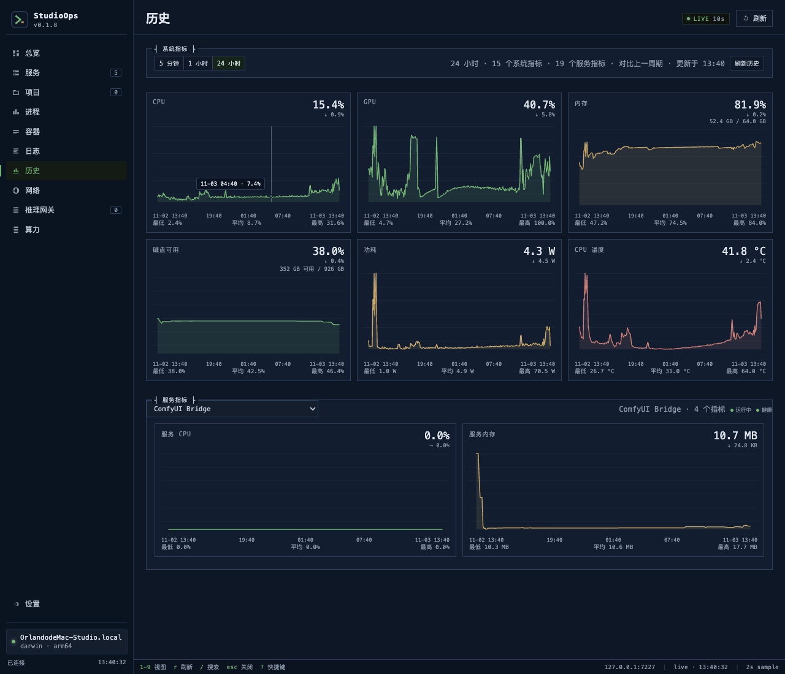

<div align="center">


# StudioOps

**一台 Mac 上的本地 AI 服务器控制台。**

模型留在这台 Apple Silicon Mac 上。香港 VPS 只做门面：SSH 登录和模型 API 都先到 VPS，再经反向隧道回到本机。Mac 不开放公网端口。

[](https://www.apple.com/macos/)
[](https://nodejs.org/)
[](https://tauri.app/)
[](tests/)
[](LICENSE)

</div>


<p align="center">
  
</p>

<p align="center"><sub>历史：5 分钟、1 小时、24 小时、1 周和已保留的总历史</sub></p>

StudioOps 目前是 pre-1.0。它管的是这台机器能不能稳定接请求，不是一个聊天窗口。

## 这套系统在干什么

一个人用一台 Mac 给自己和几个朋友提供本地模型。StudioOps 是这台机器的控制面，负责四件事：

1. **服务还在不在。** Ollama、ComfyUI、视频桥、反向隧道和 LaunchAgent 统一启动、保活、看日志。
2. **请求会不会把内存打满。** 外部调用先进入本机 Inference Gateway，排队、限并发、超时，内存不够就拒绝。
3. **同一时间只留一个文本模型。** 拉起另一个模型时，先卸掉空闲的那个。正在回答的模型不会被中途杀掉。
4. **谁进来了、机器现在什么样。** 记录每次调用的模型和 token 数量，画系统历史，并在地图上区分入站和出站。

它不是聊天客户端，不自己跑模型，也不是多租户云平台。Ollama、ComfyUI 和 MiniMax H3 仍由它们自己的进程推理。

## 流量怎么走

```text
朋友 / CI
  │
  ├─ SSH
  │    VPS:2222  Warpgate（公钥、会话录像）
  │    → VPS 127.0.0.1:22022
  │    → SSH 反向隧道
  │    → Mac 127.0.0.1:22
  │    → 标准用户 compute
  │
  └─ 模型 API
       VPS:443  Sub2API（Key、额度、模型名）
       → VPS 127.0.0.1:11434 / 8190
       → SSH 反向隧道
       → Mac Inference Gateway
       → Ollama / ComfyUI
```

视频不在这条公网路径上，只听本机 `8192`。

VPS 不跑模型，也不保存 Mac 上的模型文件。朋友只需要 VPS 的地址和一把 Key，不需要这台 Mac 的 IP。

吊销访问有两个地方：StudioOps 里删掉 `compute` 的公钥，或在 Sub2API 里停掉那把 API Key。

## 控制台里有什么

桌面窗口是 Tauri 2，页面也由本机 Agent 提供，地址是 <http://127.0.0.1:7227>。

| 视图 | 看什么 |
| --- | --- |
| 总览 | 服务是否在跑、CPU、内存、GPU、温度 |
| 服务 / 项目 / 进程 / 容器 | launchd、进程、Compose 和健康检查 |
| 日志 | 某个服务的实时日志 |
| 历史 | 5 分钟、1 小时、24 小时、1 周、总历史。1 周和总历史用小时聚合，小时数据默认留 365 天。总历史不和上一周期对比 |
| 网络 | 世界地图。绿色入站，金色出站，光点沿弧线移动。回环、局域网和 Tailscale 不画 |
| 推理网关 | 三个队列、模型调用记录。Token 列是输入+输出=合计。不记录 prompt |
| 算力 | `compute` 用户的会话、进程、磁盘、登录历史，以及发给朋友的接入说明 |
| 设置 | 采样保留、告警、Tailscale、备份、卸载 |

快捷键：`1–8` 切视图，`r` 刷新，`/` 搜索，`Esc` 关闭。

### 入站为什么要单独算

本机 `lsof` 只能看到 TCP 对端。朋友的请求到了香港 Sub2API，再从反向隧道进来，Mac 上的对端是 `127.0.0.1`，所以光看本机套接字，公网入站永远是 0。

控制面会通过 SSH 主机 `vps` 读取 Sub2API 最近 24 小时的调用来源，把公网 IP 画成绿色入站，并标上上次时间和次数。数据库密码留在 VPS 容器里，不进这个仓库。出站仍是这台 Mac 自己向外拨出的连接。

同一城市只画一条线。地理信息来自 `ipwho.is`，不抓包，不保存请求内容。说明见 [网络地图](docs/network-map.md)。

### 发给朋友的说明

算力页可以复制一段给别人的 Agent 看的接入说明。真实地址、模型名和 Key 写在本机的 `apps/web/share.local.json`，这个文件已忽略，不会进 Git。仓库里只有 [`apps/web/share.example.json`](apps/web/share.example.json) 的占位。

公网目前开放文本和文生图。视频在说明里会写成不要对公网调用。

## 界面截图

<p align="center">
  
  
</p>

<p align="center"><sub>推理网关的三个队列和调用记录 · 服务的 launchd、Bridge 和健康状态</sub></p>

<p align="center">
  
  
</p>

<p align="center"><sub>compute 用户审计 · VPS 2222 上的 Warpgate，以及 Mac 的 22 只听回环</sub></p>

## 各部件放在哪

| 部件 | 在哪 | 做什么 |
| --- | --- | --- |
| Warpgate | 香港 VPS | SSH 公钥认证、会话录像、转到 Mac |
| Sub2API | 香港 VPS | 模型 API 的 HTTPS、API Key、额度和对外模型名 |
| SSH 反向隧道 | Mac → VPS | 把 VPS 回环端口接到 Mac，由 Mac 主动连出去 |
| StudioOps Agent | Mac `127.0.0.1:7227` | 控制面：服务、历史、地图、审计 |
| Inference Gateway | Mac 回环 | 队列、并发、超时、内存准入、调用记录 |
| Ollama / ComfyUI / H3 | Mac | 真正的推理 |

```text
Ollama:       11435 → 11434
ComfyUI 图片: 8191  → 8190
H3 视频:      8192  → 8193 → 8188
Gateway 管理: 11436
```

端口：

| 端口 | 位置 | 用途 | 公网 |
| --- | --- | --- | --- |
| `2222/tcp` | VPS | Warpgate SSH | 是 |
| `443/tcp` | VPS | Sub2API / 站点 | 是 |
| `22/tcp` | VPS | 管理员 SSH | 建议限制来源 |
| `8888` | VPS 回环 | Warpgate 管理台 | 否 |
| `22022` | VPS 回环 | 反向隧道到 Mac 22 | 否 |
| `11434` / `8190` | VPS 回环 | 反向隧道到 Gateway | 否 |
| `7227` | Mac 回环 | StudioOps Agent | 否 |
| `11435` / `8191` / `8192` / `11436` | Mac 回环 | Inference Gateway | 否 |
| `22` | Mac 回环 | sshd，只给反向隧道 | 否 |

不要把 Mac 的 `22`、`7227`、`11434`、`8190`、`8192` 映射到公网。

## 机器要求

### Mac

| 项目 | 最低 | 这台机器上的用法 |
| --- | --- | --- |
| 芯片 | Apple Silicon | arm64 |
| 系统 | macOS 14 | 桌面端和 `vm_stat` 内存采样 |
| 内存 | 32 GB | 64 GB 才能同时考虑 ComfyUI 或 H3。文本模型仍只留一个 |
| 磁盘 | 100 GB 可用 | 模型文件不在这个仓库里 |
| Node.js | 22.5+ | Agent 用内置 `node:sqlite` |
| 运行时 | Ollama | 另有 ComfyUI 和 H3 视频桥 |

给朋友或 CI 登录时使用标准用户 `compute`，不要给管理员权限。Tailscale 只作为私网入口，不启用 Funnel。

### VPS

VPS 不需要 GPU。1 到 2 个 vCPU、1 到 2 GB 内存、Debian 12 和 Docker 就够跑 Warpgate 与 Sub2API。模型延迟主要来自 Mac 的推理和上行，不来自 VPS 的算力。

SSH 不需要域名。模型 API 用一个子域名和证书。防火墙只放行 `2222`、`443` 和管理 SSH。

## 本机怎么同时保护内存

Gateway 读三样东西：`vm_stat` 里的 active + wired + compressed、Ollama `/api/ps` 里已加载的模型、自己正在跑的任务。

```text
推理预算：总内存 − 12 GB
硬性安全线：至少 2 GB 可用
文本模型：最多 1 个已加载模型，空闲的先卸掉
ComfyUI：至少 24 GB 可用
H3 视频：至少 30 GB 可用
```

队列满返回 `429`。内存不够返回 `503`。上下文超过窗口返回 `400`。换模型会冷启动；正在回答的那个不会被卸掉。

默认队列：

| 后端 | 端口 | 并发 | 队列 | 排队超时 | 请求超时 |
| --- | ---: | ---: | ---: | ---: | ---: |
| Ollama | 11435 | 2 | 8 | 60 秒 | 10 分钟 |
| ComfyUI 图片 | 8191 | 1 | 8 | 30 分钟 | 30 分钟 |
| H3 视频 | 8192 | 1 | 8 | 30 分钟 | 60 分钟 |

调用记录在：

```text
~/Library/Application Support/com.studioops.desktop/gateway/model-calls.jsonl
```

记下模型、后端、路线、状态、耗时和 token 数量。不写 prompt、messages、图片或 Authorization。

```bash
curl http://127.0.0.1:11436/health
curl http://127.0.0.1:11436/status
curl 'http://127.0.0.1:11436/records?limit=50'
```

## 快速开始

```bash
npm install
cp config/services.example.yaml config/services.yaml
npm run dev
```

打开 <http://127.0.0.1:7227>。

`config/services.yaml` 已忽略。不要提交真实路径、Token 或账号。

桌面 App：

```bash
npm --prefix apps/desktop install
npm run desktop:dev
# 安装包
npm run desktop:build
```

产物在 `apps/desktop/src-tauri/target/release/bundle/macos/StudioOps.app`。构建时会先打包 Agent 和 Gateway。装到 `/Applications` 之后，窗口里的页面是打进 App 的那一份；改完页面要重新构建并完全退出再打开。Agent 读的是 App 里的 `Resources`，替换文件后需要让监听 `7227` 的进程重新起来。

### 接上 VPS

1. VPS 上用 Docker 跑 Warpgate：SSH `0.0.0.0:2222`，管理台 `127.0.0.1:8888`，打开会话录像。
2. Warpgate 目标 `mac-compute`：`127.0.0.1:22022`，用户 `compute`，公钥认证。
3. Mac 上保持反向隧道。`scripts/ollama-tunnel` 会读 `~/.ssh/config` 里的 `Host vps`：

   ```bash
   ssh -N \
     -R 127.0.0.1:22022:127.0.0.1:22 \
     -R 127.0.0.1:11434:127.0.0.1:11435 \
     -R 127.0.0.1:8190:127.0.0.1:8191 \
     -L 127.0.0.1:18888:127.0.0.1:8888 \
     vps
   ```

4. 把 Mac 的 sshd 收到回环：`sudo bash scripts/ssh-loopback-mode.sh gateway`
5. 在「算力 → SSH 网关」贴上朋友的公钥。
6. 朋友连接：`ssh -p 2222 compute-guest:mac-compute@VPS的地址`

模型 API 走 VPS 上的 Sub2API，转发到上面的 `11434` 和 `8190`。不要让朋友直接打 Mac 的端口。视频要对外时再单独加 `8192` 的隧道，现在没有。

细节和回滚见 [SSH 网关](docs/ssh-gateway.md)。

## 配置

```yaml
services:
  - id: ollama
    name: Ollama
    kind: ollama
    adapter: launchd
    target: gui/501/ai.local.ollama
    allowedActions: [start, stop, restart]
    health:
      type: http
      endpoint: http://127.0.0.1:11434/api/tags
```

适配器：`launchd`、`process`、`docker-compose`、`cloudflared`。

`kind`：`ollama`、`comfyui`、`process`、`launchd`、`docker-compose`、`tunnel`、`generic`。

字段见 `config/services.example.yaml`。网页不能提交任意 shell 或路径，动作必须在白名单里。

## 安全

- Agent、Gateway 和模型端口都绑在 `127.0.0.1`
- 非本机访问 Agent 需要 Bearer Token，文件权限 `0600`
- 公网只开放 VPS 的 `2222` 和 `443`
- Mac 的 sshd 只听 `127.0.0.1:22`，远程登录必须先过 Warpgate
- 删公钥即吊销 SSH。Tailscale 只对 tailnet 开放，不用 Funnel
- 证书、私钥、`.env`、SQLite、日志、`services.yaml` 和 `share.local.json` 不进 Git

不要把 `7227` 暴露到公网。发现问题不要开公开 issue，先私下联系维护者，见 [SECURITY.md](SECURITY.md)。

## 开发

```bash
npm run typecheck
npm test
npm run format:check
cargo test --manifest-path apps/desktop/src-tauri/Cargo.toml
```

85 个 TypeScript 测试，覆盖配置、适配器、鉴权、告警、指标历史、网络入站和 Gateway 的队列、内存与 token 记录。

```text
services/agent      控制面：HTTP、WebSocket、适配器、指标、网络
services/gateway    队列、内存准入、调用记录
packages/contracts  共用类型
apps/web            终端风格页面
apps/desktop        Tauri 2 外壳
docs                架构、网关、H3、Tailscale、卸载
scripts             安装、隧道、ComfyUI / H3 桥
tests               TypeScript 测试
```

## 现在的边界

- 只支持 macOS。没有 cgroup，内存保护是应用层准入，不是内核硬限制
- H3 很慢，也还没映射到 VPS。64 GB 机器上，864×480、5 秒、4 步大约 225 秒，见 [H3 验证](docs/minimax-h3.md)
- API Key 和额度在 Sub2API，不在 Gateway 里。Gateway 不做按用户计费
- 换模型前，如果内存已经超过预算，空闲模型有时来不及先卸掉就被 `503` 拒绝
- Agent 的远程鉴权还在收紧，完成前只从本机或 VPS 回环访问
- 没有代码签名、公证和自动更新。CI 目前只构建 DMG
- 模型文件不在仓库里。配置和 API 在 1.0 前还会变

## 文档

- [技术架构](docs/architecture.md)
- [Inference Gateway](docs/inference-gateway.md)
- [MiniMax H3](docs/minimax-h3.md)
- [Tailscale](docs/tailscale.md)
- [cloudflared](docs/cloudflared.md)
- [网络地图](docs/network-map.md)
- [算力用户](docs/compute-user.md)
- [SSH 网关](docs/ssh-gateway.md)
- [卸载与恢复](docs/uninstall.md)
- [开发交接](docs/agent-handoff.md)

## 参考

界面和取舍参考过 [mac-dash](https://github.com/talhaorak/mac-dash)、[macmon](https://github.com/vladkens/macmon)、[Ollama](https://ollama.com/)、[ComfyUI](https://www.comfy.org/)、[MiniMax H3](https://github.com/MiniMax-AI/MiniMax-H3)、[llama-swap](https://github.com/mostlygeek/llama-swap)、[LiteLLM](https://www.litellm.ai/) 和 [Off Grid AI Desktop](https://github.com/off-grid-ai/OGAD)。StudioOps 是独立项目，不隶属于它们。

## License

[MIT](LICENSE) © 2026 StudioOps contributors
