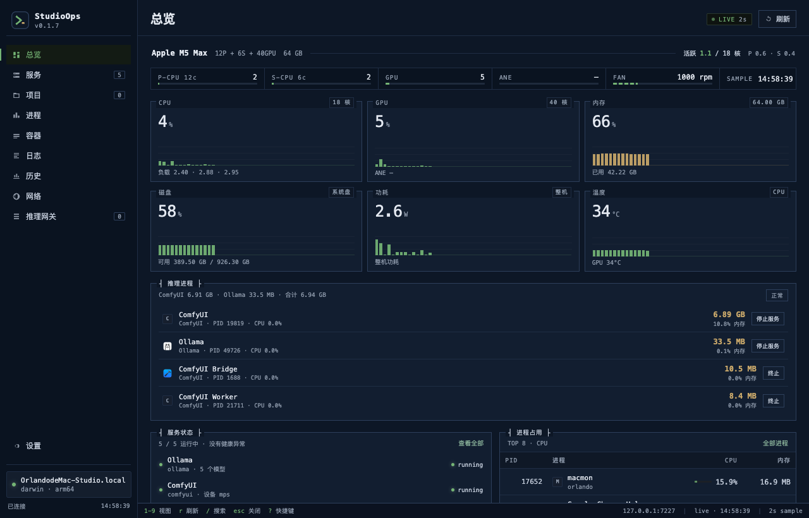
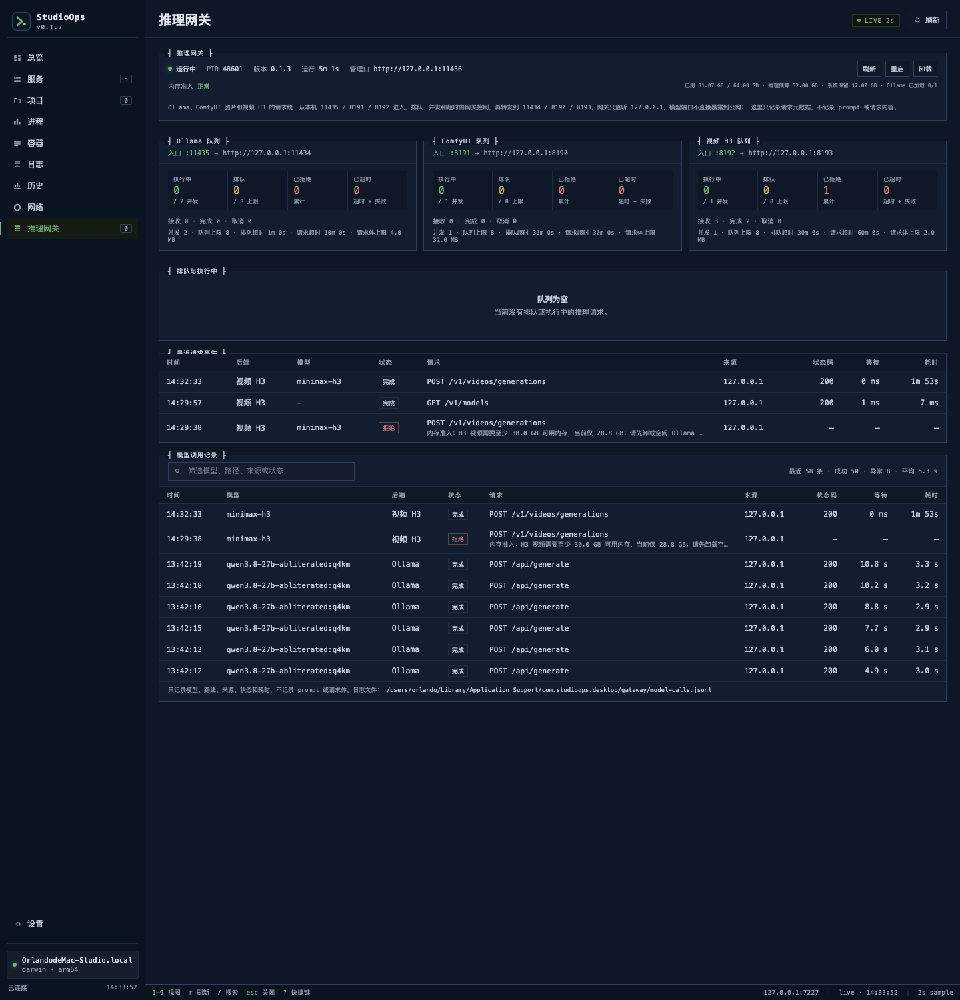
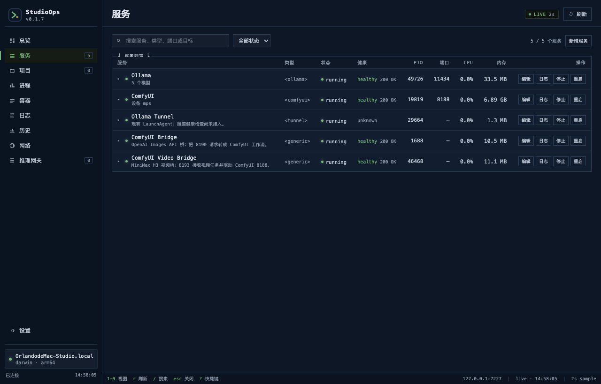
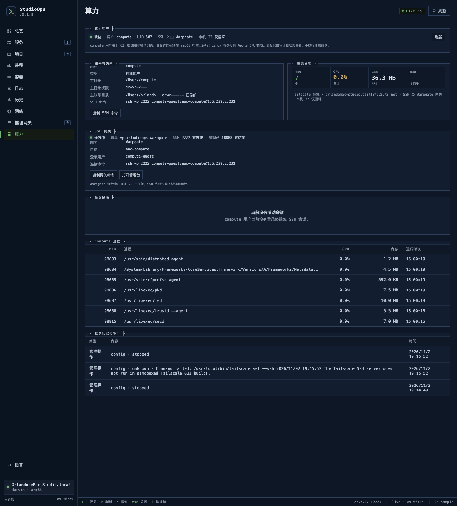
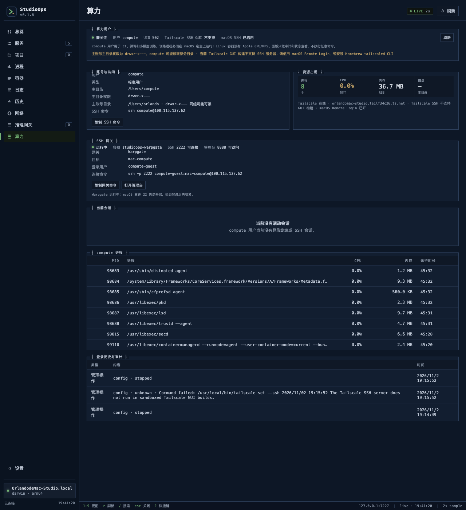

<div align="center">


# StudioOps

**A local-first control plane for macOS AI servers.**

把 Ollama、ComfyUI、MiniMax H3 视频、launchd 常驻服务、请求队列和内存保护放进一个本地控制台。

[](https://www.apple.com/macos/)
[](https://nodejs.org/)
[](https://tauri.app/)
[](tests/)
[](LICENSE)

</div>



## 界面截图

<p align="center">
  
  
</p>

<p align="center"><sub>推理网关：Ollama / ComfyUI / 视频 H3 三个队列与模型调用记录 · 服务：launchd、Bridge 和健康状态</sub></p>

<p align="center">
  
</p>

<p align="center"><sub>算力用户：独立 compute 标准用户的会话、进程、磁盘、登录历史、SSH 状态和审计</sub></p>

<p align="center">
  
</p>

<p align="center"><sub>Warpgate SSH 网关 PoC：2222 入口、目标、连接命令和直连 22 风险提示</sub></p>

> StudioOps 目前是 pre-1.0 项目。它优先解决一台 Mac 上“AI 服务能稳定跑、不会把内存打爆、外部请求能排队”的问题，而不是做一个聊天客户端。

## 为什么做 StudioOps

在 Mac 上跑本地 AI，常见状态是：

- Ollama、ComfyUI、Compose 项目和各种脚本散落在多个终端里
- 服务没有统一的开机启动、崩溃恢复、日志和健康检查
- 外部请求直接打模型端口，没有队列、并发限制和超时
- Ollama 和 ComfyUI 同时加载大模型，把统一内存和 swap 打满
- 远程访问靠临时 SSH 隧道，缺少审计和安全边界
- 出问题只能看进程列表，不知道是谁、什么时候、调用了哪个模型

StudioOps 把这些事情收进一个 macOS 原生控制台：

```text
服务生命周期 + AI 运行时 + 请求网关 + 内存准入 + 可观测性 + 私网访问
```

## 主要能力

### 服务控制面

- 统一管理 `launchd`、普通进程、Docker Compose、cloudflared
- 启动 / 停止 / 重启 / 暂停 / 恢复，动作白名单约束
- 开机启动、KeepAlive、崩溃恢复、日志和健康检查
- 项目服务可生成独立 LaunchAgent
- 进程身份持久化，Agent 重启后仍能识别原进程
- 配置写入前校验、自动备份、热加载和回滚

### AI 运行时与内存保护

- Ollama 模型列表、加载/卸载、VRAM、内存占用和到期时间
- ComfyUI 队列、历史、MPS VRAM、中断和取消
- 读取 macOS `vm_stat`，按推理预算和系统保留线做准入
- Ollama 模型槽位限制，空闲模型自动卸载
- ComfyUI 图片和 H3 视频分别设置可用内存门槛
- 内存紧张时拒绝新任务，而不是让系统进入 OOM

### Inference Gateway

外部请求不再直接访问模型端口：

```text
Ollama:       11435 → 11434
ComfyUI 图片: 8191  → 8190
H3 视频:      8192  → 8193 → 8188
管理 API:     11436
```

- 每个后端独立的并发、队列上限、排队超时和请求超时
- 队列满返回 `429`，内存不足返回 `503`
- 客户端断开时取消排队或中止上游
- 支持流式响应，不缓冲完整模型输出
- 持久化模型调用记录：模型、后端、状态、耗时、来源
- 默认不记录 prompt、请求体或 Authorization

### 可观测性

- 2 秒系统指标、5 秒服务状态 WebSocket 推送
- SQLite 指标历史：5 分钟 / 1 小时 / 24 小时
- 服务掉线、操作失败、内存、磁盘、温度告警
- 实时日志流、搜索、错误高亮和轮转重置
- 操作审计，记录 actor 和 Tailscale 远程身份
- 公网入站/出站连接世界地图，不抓包

### 远程访问与安全

- 所有服务默认只监听 `127.0.0.1`
- 非回环访问必须使用 Bearer Token
- Tailscale Serve 只对 tailnet 开放，不启用 Funnel
- 项目可以单独开放 Tailnet 入口
- 安全审计检查敏感端口、Funnel、Token 和 ACL 风险
- 服务目标来自受控 YAML，不接受网页提交任意 shell 或路径
- 算力用户：独立 `compute` 标准用户的会话、进程、磁盘、登录历史、Tailscale SSH 状态和审计

### 桌面体验

- Tauri 2 原生窗口，关闭后保留菜单栏
- Agent 异常退出自动重启
- 单实例、启动错误弹窗、配置错误横幅
- 终端风格面板，`1–8` 切视图、`r` 刷新、`/` 搜索、`Esc` 关闭
- 一张面板里同时看服务、模型、队列、日志、指标和历史

## 架构

```text
┌──────────────────────┐      ┌──────────────────────┐
│ Tauri 2 desktop      │      │ Browser / Tailnet    │
│ 主入口 / 菜单栏       │      │ Web companion        │
└──────────┬───────────┘      └──────────┬───────────┘
           └──────────────┬──────────────┘
                          ▼
              ┌────────────────────────┐
              │ Local Agent            │
              │ Hono API + WebSocket   │
              │ auth / audit / registry│
              └────────────┬───────────┘
                           ▼
       ┌────────────┬────────────┬────────────┬────────────┐
       │ launchd    │ Docker     │ AI         │ Tunnel     │
       │ adapter    │ adapter    │ runtime    │ adapter    │
       └────────────┴────────────┴────────────┴────────────┘

外部推理流量：

Sub2API / 客户端
  → SSH / Tailscale
  → Inference Gateway（队列、并发、超时、内存准入）
  → Ollama 11434 / ComfyUI 8188 / H3 Video Bridge 8193
```

## 快速开始

### 环境要求

- macOS 14 Sonoma 或更高
- Node.js **22.5+**（Agent 使用内置 `node:sqlite`）
- npm
- 可选：Rust / Tauri 2 工具链（构建桌面 App）
- 可选：Ollama、ComfyUI、Docker Desktop

### 启动 Web 控制台

```bash
npm install
cp config/services.example.yaml config/services.yaml
npm run dev
```

打开 <http://127.0.0.1:7227>。

`config/services.yaml` 是本机私有配置，已经被 `.gitignore` 忽略。不要提交真实路径、Token 或账号信息。

### 构建桌面 App

```bash
npm --prefix apps/desktop install
npm run desktop:dev
# 或
npm run desktop:build
```

构建产物默认在：

```text
apps/desktop/src-tauri/target/release/bundle/macos/StudioOps.app
```

构建前会同时打包 Agent 和 Gateway：

```bash
npm run build:services
```

## 配置示例

```yaml
services:
  - id: ollama
    name: Ollama
    kind: ollama
    adapter: launchd
    target: gui/501/ai.local.ollama
    allowedActions: [start, stop, restart]
    health:
      type: http
      endpoint: http://127.0.0.1:11434/api/tags

  - id: comfyui
    name: ComfyUI
    kind: comfyui
    adapter: launchd
    target: gui/501/ai.local.comfyui
    allowedActions: [start, stop, restart]
    health:
      type: http
      endpoint: http://127.0.0.1:8188/system_stats
```

支持的适配器：

```text
launchd / process / docker-compose / cloudflared
```

支持的 `kind`：

```text
ollama / comfyui / process / launchd / docker-compose / tunnel / generic
```

完整字段和模板见 `config/services.example.yaml`。

## Inference Gateway

Gateway 是独立 LaunchAgent，不依赖桌面 App 是否打开。

### 默认策略

| 后端         |  端口 | 并发 | 队列 | 排队超时 | 请求超时 | 请求体 |
| ------------ | ----: | ---: | ---: | -------: | -------: | -----: |
| Ollama       | 11435 |    2 |    8 |      60s |    10min |    4MB |
| ComfyUI 图片 |  8191 |    1 |    8 |    30min |    30min |   32MB |
| H3 视频      |  8192 |    1 |    8 |    30min |    60min |    2MB |

### 状态与记录

```bash
curl http://127.0.0.1:11436/health
curl http://127.0.0.1:11436/status
curl 'http://127.0.0.1:11436/records?limit=50'
```

模型调用记录默认写入：

```text
~/Library/Application Support/com.studioops.desktop/gateway/model-calls.jsonl
```

记录字段：

```text
模型 / 后端 / 状态 / 方法 / 路径 / 来源
状态码 / 等待时间 / 执行耗时 / 错误
```

不会写入 prompt、messages、图片、请求体或 Authorization。

### 内存准入

Gateway 会读取：

- macOS `vm_stat` 的 active + wired + compressed
- Ollama `/api/ps` 当前已加载模型
- 当前 Gateway 活跃任务

默认策略：

```text
推理预算：总内存 - 12GB
硬性安全线：至少 2GB 可用
Ollama：最多 1 个已加载模型
ComfyUI：至少 24GB 可用
H3 视频：至少 30GB 可用
```

内存不够时，新任务返回 `503`，不会先加载模型再失败。

## ComfyUI 与 H3 视频（可选）

StudioOps 可以只做服务器控制，不要求安装 ComfyUI/H3。需要图片或视频时再接入。

- ComfyUI 图片桥：`scripts/comfy_openai_bridge.py`
- H3 视频桥：`scripts/comfy_video_bridge.py`
- H3 验证和实测数据：`docs/minimax-h3.md`

H3 模型文件不随仓库分发。64GB M5 Max 实测：

```text
864×480 / 5 秒 / 4 步:     225 秒
864×480 / 10 秒 / 4 步:    505 秒
1344×768 / 5 秒 / 4 步:    681 秒
```

视频入口目前只监听本机，不会自动暴露到公网。

## 安全模型

- Agent、Gateway 和模型端口默认全部绑定 `127.0.0.1`
- 通过非回环地址或 Tailscale 访问时必须提供 Token
- Token 文件权限为 `0600`
- Tailscale Serve 只开放给 tailnet，不启用 Funnel
- 所有服务动作经过适配器和白名单
- 客户端不能提交任意 shell、路径或 launchd label
- Gateway 只保存请求元数据，不保存 prompt
- 证书、私钥、`.env`、SQLite、日志和本机 `services.yaml` 不进入 Git

> 如果你发现安全问题，请不要开公开 issue，先通过仓库维护者私下联系。详见 [SECURITY.md](SECURITY.md)。

## 开发

```bash
npm run typecheck
npm test
npm run format:check

# Rust 测试
cargo test --manifest-path apps/desktop/src-tauri/Cargo.toml
```

当前测试：**71 个 TypeScript 测试**，覆盖配置、适配器、鉴权、告警、指标、网络地图和 Gateway 队列/内存准入。

### 目录

```text
services/agent      本机控制层：HTTP API、WebSocket、适配器、服务注册表
services/gateway    Inference Gateway：代理、队列、内存准入、模型调用记录
packages/contracts  Agent / Web / Desktop 共用契约
apps/web            终端风格 Web 控制台
apps/desktop        Tauri 2 桌面壳
docs                架构、网关、H3、Tailscale、卸载和交接文档
scripts             安装/卸载、隧道、ComfyUI/H3 桥
tests               TypeScript 测试
```

### 提交前检查

```bash
npm run typecheck
npm test
npm run format:check
cargo test --manifest-path apps/desktop/src-tauri/Cargo.toml
```

## 当前限制

- 仅支持 macOS；Linux/Windows 不在当前范围内
- macOS 没有 cgroup 式硬内存限制，内存保护是应用层准入
- H3 视频模型需要数十 GB 内存和数分钟到数十分钟生成时间
- Gateway 的按用户 API Key、配额和限流还未完成
- 没有 CI、代码签名、公证和自动更新
- 模型文件、真实 `services.yaml`、证书和日志都不在仓库中
- pre-1.0，配置和 API 仍可能变化

## Roadmap

- [ ] Gateway API Key、配额和每用户限流
- [ ] 按模型大小做加载前内存预估
- [ ] Gateway / SSH 隧道健康告警
- [ ] SSH 网关（Warpgate / Teleport）：所有 SSH 先认证和审计（Warpgate PoC 已启动）
- [ ] 视频队列对外映射
- [ ] CI、签名、公证和自动更新
- [ ] 数据与配置统一备份

## 贡献

欢迎 issue 和 PR。

- 修改前先看 `docs/architecture.md` 和 `docs/agent-handoff.md`
- 不要提交真实 Token、证书、私钥、模型路径或本机日志
- 新增服务动作必须经过适配器和白名单
- 新增 UI 面板保持终端风格：等宽字体、细线边框、`data-title` 边框标题
- 提交前跑完上面的检查命令

## License

[MIT](LICENSE) © 2026 StudioOps contributors

## 文档

- [技术架构](docs/architecture.md)
- [Inference Gateway](docs/inference-gateway.md)
- [MiniMax H3 本地验证](docs/minimax-h3.md)
- [Tailscale 私网访问](docs/tailscale.md)
- [cloudflared](docs/cloudflared.md)
- [网络地图与隐私边界](docs/network-map.md)
- [卸载与恢复](docs/uninstall.md)
- [算力用户与审计](docs/compute-user.md)
- [SSH 网关与短期凭证规划](docs/ssh-gateway.md)
- [开发交接](docs/agent-handoff.md)

## Acknowledgements

StudioOps 的架构和取舍受这些项目和社区工作影响：

- [mac-dash](https://github.com/talhaorak/mac-dash)：macOS 系统面板和 launchd 管理
- [macmon](https://github.com/vladkens/macmon)：Apple Silicon GPU/ANE/功耗/温度
- [Ollama](https://ollama.com/) 与 [ComfyUI](https://www.comfy.org/)：本地模型运行时
- [MiniMax H3](https://github.com/MiniMax-AI/MiniMax-H3)：开源全模态视频模型
- [llama-swap](https://github.com/mostlygeek/llama-swap) / [LiteLLM](https://www.litellm.ai/)：本地模型切换和 AI Gateway 的参考
- [Off Grid AI Desktop](https://github.com/off-grid-ai/OGAD)：本地 AI Gateway 和团队 Key 的参考

StudioOps 自身是一个独立项目，不隶属于上述项目。
